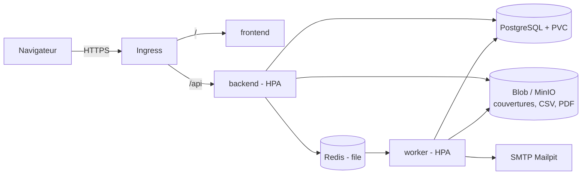

# Biblio — du code à la supervision (BC3)

Application web cloud-native de **gestion de bibliothèque** : catalogue, emprunts, réservations avec file d'attente, rappels et relances automatiques. Front React, API Node stateless, PostgreSQL, stockage objet, worker asynchrone, et toute la chaîne d'exploitation : conteneurs, Kubernetes, CI/CD, Terraform, observabilité, sécurité ISO 27001 et FinOps.

👉 **Documentation** : [architecture](docs/ARCHITECTURE.md) · [SLO et alertes](docs/SLO.md) · [sécurité ISO 27001](docs/SECURITY-ISO27001.md) · [FinOps](docs/FINOPS.md). Le déroulé complet et les captures sont dans le compte rendu remis avec le dépôt.

## Démarrage rapide (local)

```bash
cp .env.example .env        # puis remplacer toutes les valeurs "change-me"
docker compose up --build -d
```
App : http://localhost:8080 · e-mails : http://localhost:8025 · stockage objet : `docker compose exec backend node src/list-objects.js`
Catalogue de démonstration à importer : `samples/catalogue-exemple.csv`

## Ce que fait l'application

| Rôle | Peut… |
|---|---|
| **Membre** | chercher dans le catalogue, emprunter (21 j, 5 livres max), réserver un livre indisponible, suivre ses emprunts, exporter son historique en PDF |
| **Bibliothécaire** | ajouter / modifier des ouvrages, téléverser des couvertures, importer un catalogue CSV, enregistrer les retours, voir les retards |
| **Admin** | tout cela + gérer les rôles |

**Tâches de fond (worker)** : e-mail de confirmation d'emprunt · **chaque jour à 08:00** rappel J-2, passage en retard et relance (puis tous les 7 jours), expiration des réservations non retirées · e-mail « votre réservation est disponible » · import CSV · export PDF · nettoyage quotidien · sauvegarde PostgreSQL.

## Architecture



Détails et justifications : [docs/ARCHITECTURE.md](docs/ARCHITECTURE.md).

## Contenu

| Dossier | Rôle |
|---|---|
| `frontend/`, `backend/`, `worker/` | Code + Dockerfiles multi-stage non-root + tests |
| `docker-compose.yml` | Stack locale complète (+ profil `obs` : Prometheus/Grafana) |
| `k8s/` | Kustomize : `base`, composants (`azure`, `pg-tls`, `monitoring`, `minio`), overlays `standalone` / `dev` / `prod`, `canary` |
| `infra/terraform/` | AKS, réseau, ACR, Blob, Key Vault, identités, Prometheus/Grafana/Loki, cert-manager |
| `.github/` | CI/CD (OIDC, scans, rollback), arrêt planifié FinOps, Dependabot |
| `docs/` | [SLO](docs/SLO.md) · [Sécurité ISO 27001 + SoA](docs/SECURITY-ISO27001.md) · [FinOps](docs/FINOPS.md) |
| `scripts/`, `tests/load/`, `samples/` | Secrets locaux, résilience, canary · test de charge k6 · CSV de démo |

## API

| Méthode | Route | Accès |
|---|---|---|
| POST | `/api/auth/register`, `/api/auth/login` | public (login limité en débit) |
| GET | `/api/books/:id/cover` | public (image de couverture) |
| GET | `/api/users/me` | connecté |
| GET / PATCH | `/api/users`, `/api/users/:id/role` | admin |
| GET | `/api/books?q=&category=&available=true`, `/api/books/categories`, `/api/books/:id` | connecté |
| POST / PATCH / DELETE | `/api/books`, `/api/books/:id` | bibliothécaire, admin |
| POST | `/api/books/:id/cover` | bibliothécaire — multipart `file`, PNG/JPEG/WebP, 2 Mo |
| GET / POST | `/api/loans` | connecté (un membre ne voit que ses emprunts) |
| POST | `/api/loans/:id/return` | bibliothécaire, admin |
| GET / POST / DELETE | `/api/reservations`, `/api/reservations/:id` | connecté |
| GET / POST | `/api/imports` | bibliothécaire — multipart `file` `.csv`, 1 Mo, **202** |
| POST | `/api/exports` | connecté — **202**, PDF généré par le worker |
| GET | `/api/exports/:id`, `/api/exports/:id/download` | propriétaire |
| GET | `/healthz`, `/readyz`, `/metrics` | interne (non exposés par l'Ingress) |
