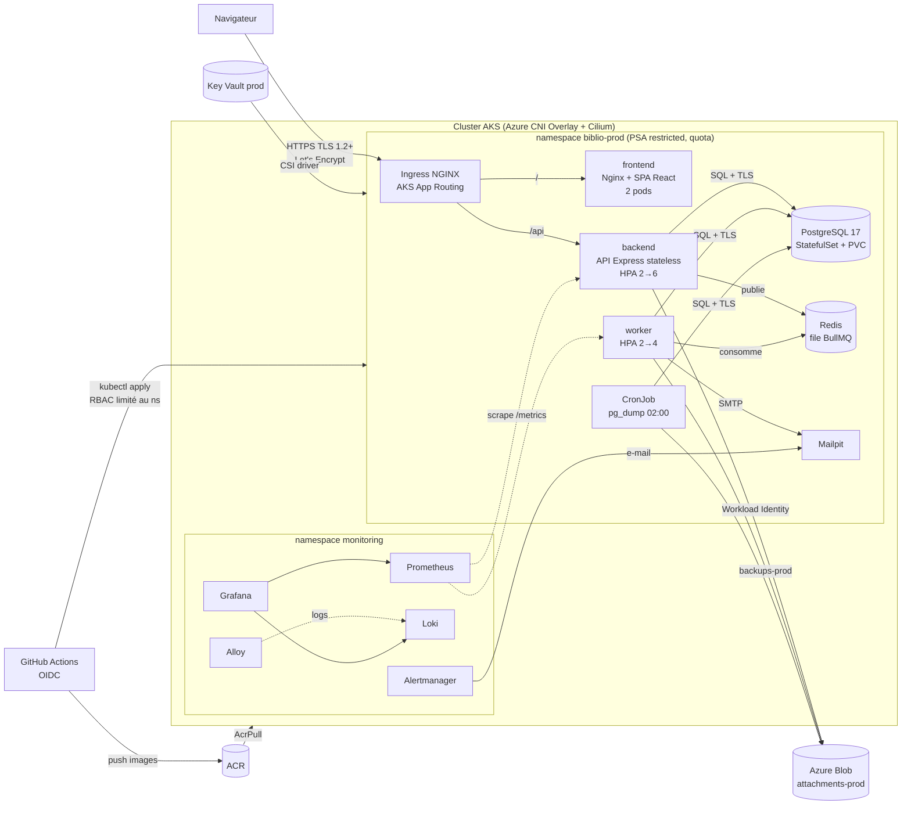

# Architecture

## Vue d'ensemble



## Choix techniques et justifications

| Brique | Choix | Pourquoi | Alternative écartée |
|---|---|---|---|
| Front | React 19 + Vite, servi par Nginx non-root | SPA légère (~76 Ko gzip), image ~20 Mo | Rendu serveur (Next.js) : inutile pour 4 écrans |
| Back | Node 22 + Express, JWT HS256 | API stateless → scalable horizontalement sans session partagée | Sessions en Redis : ajoute un état partagé |
| BDD | PostgreSQL 17 en StatefulSet + PVC (disque managé Azure) | Démontre le stockage persistant K8s exigé par le sujet, coût ~0 € | Azure Database for PostgreSQL Flexible : ~15–25 €/mois en plus, moins pédagogique pour la partie PV |
| File de messages | Redis 7 + BullMQ | Simple, retries + backoff + **tâches planifiées (cron) intégrées**, un seul déclenchement même avec N workers | RabbitMQ : pas de planification native ; CronJob K8s : bien pour un script isolé (sauvegarde) mais pas pour des milliers d'e-mails réessayables |
| Stockage objet | Azure Blob (prod/dev), MinIO (local) | Pilote unique `storage.js`, Workload Identity = aucune clé | Azure Files : pas un stockage objet |
| Secrets | Key Vault + Secrets Store CSI Driver | Source de vérité hors cluster, rotation, audit Azure | Sealed Secrets : secrets chiffrés dans Git, moins standard sur Azure |
| Ingress | Add-on App Routing (NGINX managé par AKS) | Maintenu et mis à jour par Microsoft, 1 seule IP publique | Installer ingress-nginx soi-même : projet communautaire en fin de vie |
| CNI / NetworkPolicy | Azure CNI Overlay + Cilium | NetworkPolicies appliquées, pas de consommation d'IP du VNet par les pods | kubenet : en dépréciation |
| IaC | Terraform (azurerm, helm, kubernetes) | Cluster + stockage + réseau + plateforme reproductibles depuis zéro | Bicep : limité à Azure (pas de Helm) |
| Manifests | Kustomize (base + composants + overlays) | Natif `kubectl -k`, lisible, pas de templating | Helm chart maison : plus de code pour 3 environnements |
| CI/CD | GitHub Actions + OIDC | Aucun secret cloud stocké, environnements avec approbation | GitLab CI : équivalent, au choix |
| Observabilité | kube-prometheus-stack + Loki + Alloy | Standard du marché, gratuit, dashboards as code | Container Insights : facturé au Go de logs |

## Flux principaux

**Emprunt** : navigateur → Ingress → backend (`POST /api/loans`) → **transaction** : vérification des règles (pas de retard en cours, 5 emprunts max, pas déjà emprunté) → décrément **atomique** des exemplaires disponibles (`UPDATE … WHERE available_copies > 0` : deux personnes ne peuvent pas prendre le dernier exemplaire) → INSERT `loans` (retour à J+21) → `queue.add('email')` → 201. Le worker envoie la confirmation.

**Réservation et file d'attente** : un membre réserve un ouvrage sans exemplaire disponible (`waiting`). Au **retour** d'un exemplaire (`POST /api/loans/:id/return`), dans la même transaction : s'il y a une file, l'exemplaire est **mis de côté** pour le premier (`available`, 3 jours) et le worker l'avertit par e-mail ; sinon il revient en rayon.

**Tâche quotidienne (08:00, planifiée par BullMQ)** : le worker
1. envoie un rappel aux emprunts qui arrivent à échéance dans 2 jours,
2. passe en `overdue` les emprunts dépassés et relance (puis tous les 7 jours),
3. fait expirer les réservations non retirées et passe l'exemplaire au suivant.

Elle est idempotente (colonnes `reminder_sent_at`, `overdue_notified_at`) et un seul déclenchement a lieu même avec plusieurs réplicas du worker. Chaque e-mail est une tâche séparée, réessayée individuellement. Déclenchement manuel pour la démo : `node src/run-now.js daily-loans`.

**Couverture (téléversement)** : `POST /api/books/:id/cover` (multipart, 2 Mo max, PNG/JPEG/WebP) → le fichier reste en mémoire → `storage.put()` vers Blob/MinIO (`covers/<id>/<uuid>`). La lecture `GET /api/books/:id/cover` est publique (une balise `` ne peut pas envoyer de jeton), avec cache HTTP.

**Import CSV du catalogue (téléversement + traitement asynchrone)** : le bibliothécaire envoie un CSV → stocké dans le stockage objet (`imports/<uuid>.csv`) → ligne `imports` (pending) + tâche `catalog-import` → **202 immédiat**. Le worker relit le fichier depuis le stockage, valide chaque ligne, crée les ouvrages, ignore les ISBN déjà présents, enregistre le bilan et envoie un e-mail récapitulatif.

**Export PDF** : `POST /api/exports` → tâche `pdf-export` → 202 ; le worker génère l'historique d'emprunts du membre (pdfkit) dans le stockage objet ; le front interroge `GET /api/exports/:id` puis télécharge.

**Autres tâches planifiées** : nettoyage à 03:00 (exports > 7 j, CSV > 30 j, en base et dans le stockage) ; sauvegarde `pg_dump` à 02:00 (CronJob Kubernetes).

## Modèle de données

```mermaid
erDiagram
  USERS ||--o{ LOANS : emprunte
  USERS ||--o{ RESERVATIONS : réserve
  BOOKS ||--o{ LOANS : "est emprunté"
  BOOKS ||--o{ RESERVATIONS : "est réservé"
  USERS ||--o{ IMPORTS : "téléverse"
  USERS ||--o{ EXPORTS : demande
  USERS { int id PK; string email UK; string role "member|librarian|admin" }
  BOOKS { int id PK; string isbn UK; string title; string author; string category; int total_copies; int available_copies; string cover_key }
  LOANS { int id PK; int book_id FK; int user_id FK; date due_at; date returned_at; string status "active|overdue|returned" }
  RESERVATIONS { int id PK; int book_id FK; int user_id FK; string status "waiting|available|fulfilled|cancelled|expired"; date expires_at }
  IMPORTS { int id PK; string object_key; string status; int created_count; int skipped_count }
  EXPORTS { int id PK; int user_id FK; string status; string object_key }
```

4 entités métier (users, books, loans, reservations) ; `imports` et `exports` sont des tables techniques de suivi des tâches asynchrones.

## Environnements

| | standalone | dev | prod |
|---|---|---|---|
| Cluster | kind / minikube / cluster de l'école | AKS (partagé) | AKS (partagé) |
| Namespace | `biblio` | `biblio-dev` | `biblio-prod` |
| Stockage objet | MinIO | Blob `attachments-dev` | Blob `attachments-prod` |
| Secrets | fichiers `.env` non commités | Key Vault dev | Key Vault prod |
| TLS PostgreSQL | non | oui | oui |
| Réplicas backend (HPA) | 1 → 3 | 1 → 3 | 2 → 6 |
| Déploiement | manuel | auto sur `main` | tag `v*` + approbation |

Arbitrage : dev et prod partagent un cluster (FinOps). La séparation repose sur les namespaces, des identités, Key Vault et conteneurs Blob distincts, des NetworkPolicies et des quotas. En production réelle, on séparerait aussi les clusters (voire les abonnements).
